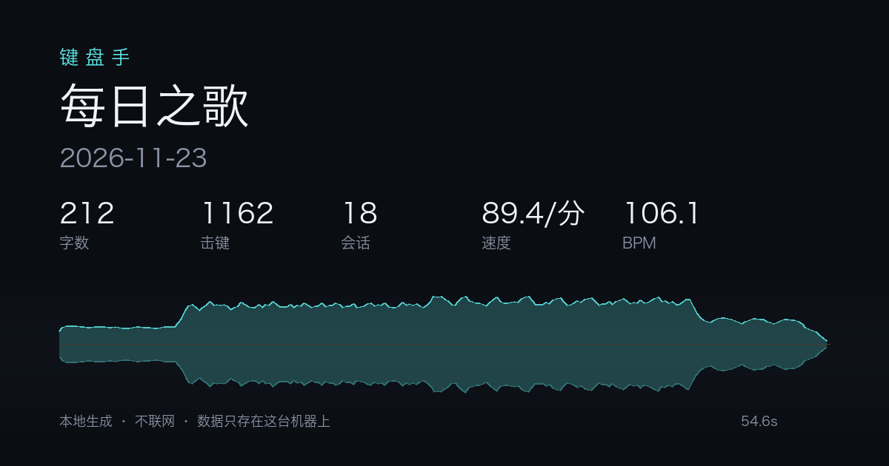

# 键盘手 · Keyboardist

> 监听打字，把每一次敲击变成屏幕底部的辉光；一天结束时，把今天的输入写成一首歌。

当前版本 **v0.2（M2 完成）**：全局采集 + 精准字数 + 屏幕底部实时辉光 + 菜单栏今日画像 + **每日之歌**。

## 效果

| 每日之歌 · 光河模式 | 每日之歌封面卡 |
|---|---|
|  |  |

---

## 快速开始

```bash
./scripts/build-app.sh          # 构建到 dist/键盘手.app
open "dist/键盘手.app"
```

首次运行需要授予 **系统设置 → 隐私与安全性 → 辅助功能** 权限（菜单栏图标出现即已启动）。

### 固定签名（推荐，一次搞定）

ad-hoc 签名每次重新编译都会换指纹，系统会当成新 App，要求重新授权。
建一个本地自签名证书后，TCC 记录就有了稳定依据：

```bash
./scripts/create-signing-cert.sh      # 生成 "Keyboardist Dev" 证书并信任
./scripts/build-app.sh                # 之后自动检测并使用它签名
```

验证签名稳定性的方法：

```bash
codesign -d -r- "dist/键盘手.app"
# designated => identifier "com.liyaming.keyboardist" and certificate root = H"..."
# 不含 cdhash，所以改代码重新编译后权限依然有效
```

---

## 架构

```
采集层                        聚合层                      呈现层
┌──────────────┐        ┌───────────────┐        ┌──────────────┐
│ KeyCapture   │──键码──▶│ Engine        │──火花──▶│ GlowOverlay  │
│ CGEventTap   │        │ 会话切分/速度  │        │ 底部辉光      │
└──────────────┘        │               │        └──────────────┘
┌──────────────┐        │               │        ┌──────────────┐
│ TextMeter    │──字数──▶│               │──统计──▶│ MenuBar      │
│ AX 计数       │        └───────┬───────┘        └──────────────┘
└──────────────┘                ▼
                        ┌───────────────┐
                        │ Store (JSON)  │  本地，不联网
                        └───────────────┘
```

| 文件 | 职责 |
|---|---|
| `Core/KeyCapture.swift` | CGEventTap 全局击键，自动重试授权 |
| `Core/TextMeter.swift` | AX 精准字数，中文 IME 组合态处理 |
| `Core/Engine.swift` | 会话切分、速度归一化、持久化节流 |
| `Core/KeyLayout.swift` | 键盘物理位置 → 横向坐标 / 八度 |
| `Core/ActiveWindow.swift` | 前台窗口定位：分屏/多显示器时辉光跟随 |
| `Core/Store.swift` | 一天一个 JSON，只存整数 |
| `UI/GlowOverlay.swift` | 透明置顶穿透窗口 + CoreGraphics 辉光 |
| `UI/MenuBar.swift` | 菜单栏今日画像 |

## 每日之歌

```bash
./scripts/make-song.sh            # 今天
./scripts/make-song.sh 2026-11-23 # 指定某天
```

产出 `composer/out/<day>.m4a`（音频）、`.wav`（无损）、`.png`（封面卡）。

**三种风格**

| 风格 | 命令 | 特点 |
|---|---|---|
| 氛围 ambient | `compose.py` | 五声音阶 + 长音 Pad，催眠、适合当背景 |
| 说唱 rap | `rap.py --lyrics <txt>` | 88 BPM boom-bap 鼓机 + 本地 TTS 人声（降调 + vocal chop） |
| 流行 pop | `pop.py --day <day>` | 四踩鼓 + 侧链泵动 + supersaw 和弦 + intro/verse/chorus/outro |

说唱为什么比摇滚容易成立：嘻哈的骨架是「鼓机 + 说话」，正好是合成器和本地 TTS 的强项；
摇滚的核心是电吉他失真，没有真实采样就会变成玩具音。

**数据 → 音乐映射**

| 输入 | 音乐参数 |
|---|---|
| 每分钟击键数 | BPM（56–132） |
| 键盘物理行 | 音区：数字排 +2 八度、QWERTY +1、ASDF 0、ZXCV −1 |
| 键位横向列 | 五声音阶第 n 级（A 小调，永不跑调） |
| 最常敲的键分布 | 6 音动机，加权抽样 |
| 会话数 / 长度 | 段落结构，最忙的一段进入高潮 |
| 每段击键量 | 力度与音符密度 |
| 日期 hash | 随机种子（同一天永远同一个版本） |

配器固定四层，理由见 `composer/compose.py` 顶部注释：毡音 Pad、FM 马林巴、
颤音琴、Sub Bass——都是「击打 + 短衰减」类，和键盘击键同族。

## 可视化原型

`composer/out/visualizer.html`：用今天真实生成的音符事件驱动，空格播放/暂停，1/2/3 切换三种模式
（光河 / 声谱 / 呼吸）。调研与设计依据见 `docs/研究-音乐可视化.md`。

## 回车冲击波

按回车时，一道四色光环从**回车键那一列**（屏幕横向 0.835 处）的底边升起，经过的地方页面被推开、带轻微色散。

| 层 | 实现 |
|---|---|
| 页面快照 | ScreenCaptureKit，只在按回车那一瞬间抓一帧 |
| 透镜扭曲 | Metal：`push = 14 × 2.33 × z × e^(−z²)`，`z = x × 0.75` |
| 通道分离 | 红 1.08 / 蓝 0.92 |
| 四环 | 高斯权重混合 Aurora 四色 |
| 边缘折射 | 56px 淡出 + 60px bevel |
| 边线反光 | 未实现 |

**触发闸门**：上一次没跑完 / 150ms 冷却 / 按住不放 / 输入法组合中 / 带修饰键 / 页面不可见，六种情况都不触发。

**权限**：需要屏幕录制。没有也能用，会降级成纯发光色环。抓到的画面只在本机内存里用一次，不写盘、不上传。

诊断日志：`~/Library/Application Support/Keyboardist/halo.log`

## 版本管理

```bash
./scripts/release.sh 0.4.3   # 升版本 → 构建 → 归档 → DMG → git tag
./scripts/install.sh         # 装最新版到 /Applications 并重启
./scripts/install.sh 0.4.0   # 回滚
```

- `dist/versions/键盘手-<ver>.app`：每个版本留一份
- `/Applications/键盘手.app`：只留一个安装位（多个副本会让 TCC 出现多条同名权限条目）
- `git tag v<ver>`：代码与二进制对得上

## 数据格式

`~/Library/Application Support/Keyboardist/days/YYYY-MM-DD.json`

```json
{
  "day": "2026-11-23",
  "keystrokes": 1873,
  "chars": 962,
  "deletions": 41,
  "sessions": [{ "start": "...", "end": "...", "keystrokes": 210, "chars": 118 }],
  "minuteKeys": { "17:12": 96 },
  "keyCodes": { "0": 210, "1": 180 }
}
```

**没有任何文本内容。** 这是设计约束，不是承诺。

## 隐私

- 不链接任何网络框架，运行时零请求
- 只读 `kAXNumberOfCharacters` 或 `CFStringGetLength`，不取字符
- 密码框等安全输入（`IsSecureEventInputEnabled`）自动停止统计
- 菜单栏可随时「暂停记录」

## 路线图

- [x] **M0** 探针：验证 CGEventTap / AX 计数 / Electron 兼容性
- [x] **M1** 工程化：采集 + 计数 + 辉光 + 菜单栏
- [x] **M2** 每日之歌：特征提取 → 五声音阶映射 → 渲染 WAV + 封面卡
- [x] **M3** App 内一键生成今日之歌（⌘G）、App 图标
- [ ] **M4** 产品化：签名公证、登录项、设置页、周/年度回顾
- [x] universal 构建（arm64 + x86_64）、自签名证书、DMG 打包
- [ ] **M4** 辉光升级：光河 + 弹性物理 + Metal bloom

## 已知问题

- 中文 IME 的组合态判定依赖选区长，个别输入法可能需要单独适配
- 多显示器时每块屏都会建一个辉光窗口（暂不支持单独关闭某块屏）
- 每日之歌尚未实现


## 第三方代码

- `demo/vendor/ripppl.global.js`：ripppl 0.1.3（MIT）打包版，加了「波前先快后慢」的 shader 补丁
- 冲击波光环的数值规格来自 RedSkill 技能 `kubai-shockwave-glow`（作者 @kubai087），实现为本仓库原创
