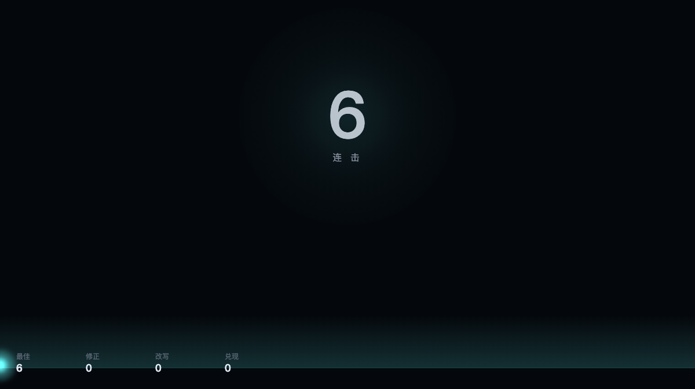
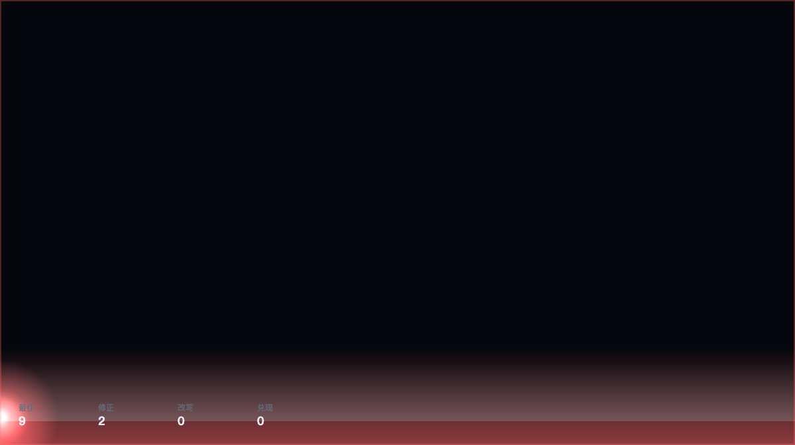
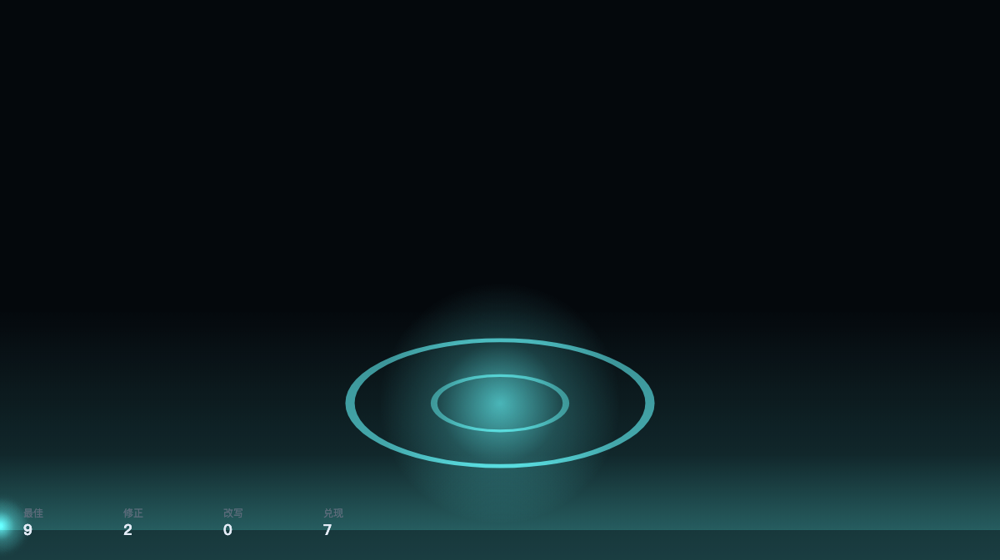

# 键盘语义地图与打字游戏化方案

> 目的：把「打字」从被统计的行为，变成有反馈、可训练、不伤人的游戏。
> 包含键盘功能语义分析、你提的四个想法的逐条评估、五套可实现的机制，以及一个能敲的原型。

---

## 一、键盘的语义地图

按「写作流程的哪个阶段」重新分类，而不是按物理分区：

| 语义类 | 阶段 | 频率 | 误触代价 |
|---|---|---|---|
| 字符键 | 输入·生成内容 | 60–70% | 低（可退格修正） |
| 空格 | 词边界 / 输入法上屏 | 15–18% | 中（词被切开、确认错候选） |
| 回车 | 提交 / 断行 | 1–3% | **高**（发送消息、提交表单，多数不可撤回） |
| 退格 / Delete | 修正·回退 | 5–10% | 低–中 |
| Tab / 方向键 | 导航 | 1–5% | 中–高（焦点跳走） |
| 修饰键 | 模式切换 | 5–10% | 高 |
| Esc | 取消 | <1% | 高 |
| 功能键 / 组合键 | 系统级 | ≈0 / 2–5% | 极高 |

**三个关键发现【实证 + 观察】**：

1. **频率最高的空格和回车，恰好是「最不可逆」的确认键。** 写作中最不可撤销的动作，由最轻、最不设防的手指完成。
2. **修正键被当成"廉价"的，但它是写作的正常器官。** 错字修订约占全部修订行为的 42%（Conijn et al. 2019），和内容重写在认知上是两件事。
3. **「构思」阶段没有任何键对应。** 键盘只服务输入、修正、提交三段——这就是为什么写作工具总觉得"打断思路"。

---

## 二、目标函数：三条线，不能混

打字游戏的通用错误是把三种东西压成一个分数：

| 线 | 指标 | 用途 |
|---|---|---|
| **速度** | WPM / 击键每分 | 参与感，但方差大，不能当唯一目标 |
| **准确** | 滚动窗口准确率、修正后准确率 | 能力线，应作为**门槛**而非加分 |
| **节奏** | 击键间隔的一致性（consistency） | 心流指标，最被忽视但最能反映状态 |

Monkeytype 的做法值得抄：wpm / raw wpm / acc / consistency 四条并列，consistency 用 raw wpm 的变异系数算。**只报 WPM 的训练器，会训练出"快而不稳"的手。**

---

## 三、你提的四个想法：逐条评估

### ① 不点删除就有连击 —— **方向对，但规则要改**

纯"零删除"连击的问题是：**它奖励"不修改"，而修改是写作质量的一部分**。长期训练的结果是"宁可留错，不要改"。

**建议改成双层连击：**

| 层 | 规则 | 作用 |
|---|---|---|
| 心流连击 | 连续输入不间断（退格**不**清零，只暂停 0.6s） | 主要反馈，奖励"在写"这件事 |
| 净手连击 | 连续无「修正」的字符数 | 加分项，不显示在中心 |

这样既保留了你想要的爽感，又不会惩罚正常编辑。

### ② 连击数量记录 —— **直接可做**

除了"本次连击"，更值得记的是：**今日最长连击、历史最佳、平均连击长度**。平均连击长度比峰值更能反映稳定的手感。

### ③ 删除键红光 —— **⚠️ 需要克制，这是唯一一条我建议改的**

研究结论很明确：

- 红色经**回避动机**降低成就任务的表现（Elliot et al. 2007, JEP:General）
- 每次退格都红闪 = 高频打断，而打断的恢复成本是 **23 分钟**（Mark 等, CHI 2008）
- 压力下过度监控程序化技能会导致 **choking**（Beilock & Carr 2001）

但**"完全不反馈"也不对**——用户需要知道自己刚才那下是不是失误。

**建议分级：**

| 情形 | 反馈 | 理由 |
|---|---|---|
| 单次修正（击键后 1.2s 内退格） | 琥珀微光，连击归零 | 中性，不评判 |
| **短时间连续修正**（4s 内 ≥2 次） | 红色**底边** + 一条细边线 | 这才是"真卡住了"的信号，红色才配得上 |
| 停顿后改写（>1.2s） | 无惩罚，计入"改写" | 编辑不是错误 |

原型里我把两种做法都实现了：整屏泛红的版本**观感像被惩罚**，改成底边光后克制很多。截图见下。

### ④ 回车全屏水波 —— **好，但要读上下文**

回车是「提交」，是全键盘最不可逆的键，用最强的反馈是对的。有两个约束：

1. **代码/表格场景回车极多**，每次都水波会变成骚扰 → 只在「间隔 > 3s 的回车」或「中文句末回车」触发
2. **强度应该和连击挂钩**：连击 5 和连击 50 的涟漪半径、环数不同

你说的「类似 iPhone 的 AI 唤起动效」——那是 iOS 18 Siri 的**边缘到边缘彩虹光晕**（iOS 27 改成了灵动岛里的光球）。两者都能做：

- **边缘光晕**：适合"提交/完成"的仪式感，成本极低（一层描边 + 模糊）
- **水波涟漪**：适合"这一下发生了"的即时感

我建议 **回车 = 边缘光晕扫过 + 地面涟漪**，两个一起给，才有"完成了一个段落"的仪式感。

---

## 四、五套可实现的机制

### 1. 心流条（替代连击）
底部一条细线，亮度 = 最近 3 秒的击键密度，不是计数。停下会缓慢变暗，而不是"断掉"。**它不惩罚，只是如实显示你的状态。**

### 2. 净手连击（可选成就）
只在侧边小字显示，断了不弹提示、不播放音效。

### 3. 句末结算
不在每次修正时给重反馈，而是在**自然停顿**（>2s）时结算一次：本句准确率 / 修正次数 / 改写次数。这是把反馈放到"不打断"的位置。

### 4. 错键热力图
只统计**同一位置连续出错**（例如 `p` 和 `;` 总是按错），一周给一次「你的弱键是 X」的建议。这是 Keybr 的思路：把错误变成训练目标，而不是扣分。

### 5. 回车仪式
边缘光晕 + 地面涟漪 + 连击兑现数字。写代码时自动降级为只有一次轻微脉冲。

---

## 五、反馈规格（工程参数）

| 元素 | 时长 | 曲线 | 颜色 |
|---|---|---|---|
| 击键火花 | 650ms | 快攻 80ms，指数衰减 | 青（冷）→ 琥珀（快） |
| 修正（单次） | 500ms | 线性淡出 | 琥珀 α 0.20 |
| 修正（连续） | 600ms | 指数淡出 | 红 α 0.42，只染底边 |
| 边缘光晕 | 900ms | ease-out | 青或红，描边 2px |
| 回车涟漪 | 1050ms | 三层波前，间隔 80ms | 青 + 内圈琥珀 |
| 连击数字 | 弹性 120ms | 过冲 1.22 倍 | 亮度随连击上升 |

**硬约束**：视觉脉冲 ≤2Hz、无整屏闪烁、夜间降色温。

---

## 六、反模式清单

1. **每次退格都红闪** → 焦虑、choking、回避
2. **连击清零 + 公开排名** → 指标替代目标（Goodhart）
3. **把准确率做成随机奖励** → 技能反馈变赌博，转移注意力
4. **把删除次数当 KPI** → 用户改用选中替换，或者干脆不写
5. **streak 焦虑** → Duolingo 式的"游戏化义务"，靠断链恐惧维持留存（ACM 质性研究）
6. **只奖励速度** → 练出高 WPM 低可靠性的习惯

---

## 七、原型

`demo/typing-gamified.html` —— 打开直接打字即可：

- 打字 → 连击 +1，底部火花
- 退格（1.2s 内）→ 判为**修正**，琥珀光，连击归零
- 4 秒内连续两次修正 → **红色底边 + 细边线**
- 停顿后退格 → 判为**改写**，不惩罚
- 回车 → 全屏水波 + 连击兑现

| 连击 | 连续修正 | 回车涟漪 |
|---|---|---|
|  |  |  |

---

## 八、下一步

1. 把「心流条 + 净手连击」接进 App 的底部辉光（复用现有 `GlowOverlay`）
2. 句末结算 + 错键热力图，进每日统计
3. 回车仪式做成可开关的设置项（代码场景默认关）
4. 等你的 iPhone 动效参考，我把边缘光晕调成那个质感

---

## 来源

- Conijn et al. 2019（错字修订占 42%）· Elliot et al. 2007 JEP:General（红色与回避动机）
- Beilock & Carr 2001（choking）· Mark, Gudith & Klocke CHI 2008（打断与 23 分钟恢复）
- Deci, Koestner & Ryan 1999（过度理由效应）· Kahneman & Tversky 1979（损失厌恶）
- Monkeytype 指标定义 · Keybr 自适应弱键 · Duolingo 游戏化批评（ACM 2025）
- Siri 边缘光晕（iOS 18）/ iOS 27 光球 · WCAG 2.3.1（闪烁限制）
